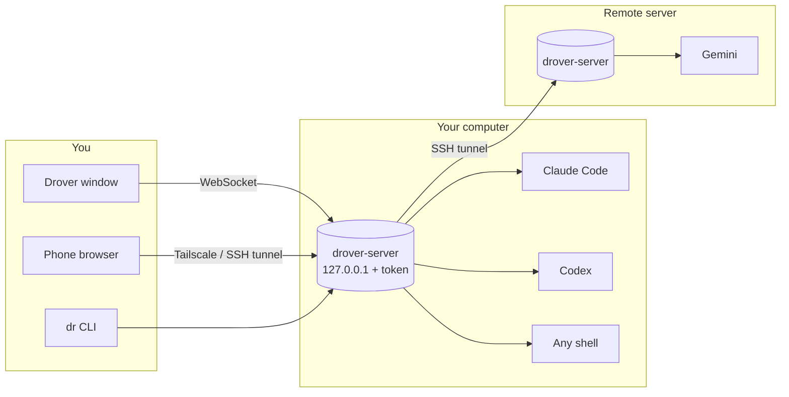

<p align="center">
  
</p>

<p align="center">
  <a href="https://github.com/doquangthanh/drover-core/releases/latest"></a>
  
  
  <a href="https://github.com/doquangthanh/drover-core/actions"></a>
</p>

<p align="center">
  <a href="https://doquangthanh.github.io/drover-core/#install"></a>
  &nbsp;
  <a href="#linux"></a>
</p>

<p align="center"><a href="https://doquangthanh.github.io/drover-core/"><b>doquangthanh.github.io/drover-core</b></a></p>

---

## What is Drover?

**Drover is one workspace for every AI coding agent you run.** Start Claude Code, Codex, Gemini, opencode or a plain
shell side by side. Drover keeps them running in the background, shows at a glance which one is working, which one is
waiting for you and which one is done, and lets you answer, review and ship their work from one window, on any of
your machines.

Run five agents at once without babysitting five terminals.

| | State | What it means |
|:-:|---|---|
| 🔵 | **Working** | The agent is busy. Leave it alone. |
| 🟠 | **Needs you** | It is asking a question or waiting for permission. You get a notification. |
| 🟢 | **Done** | It finished. Review the changes when you are ready. |
| ⚪ | **Idle** | Nothing is running in that pane. |

## Why teams use it

<table>
<tr>
<td width="50%" valign="top">

**Agents keep running**<br>
Close the window and they carry on in `drover-server`. Reopen it tomorrow and everything is where you left it.

</td>
<td width="50%" valign="top">

**Knows who needs you**<br>
State comes from each agent's screen (plain TOML rules) or from the agent itself over OSC 7501. Desktop
notifications and an Inbox of everyone waiting.

</td>
</tr>
<tr>
<td valign="top">

**Agents run agents**<br>
`dr run`, `dr wait`, `dr read` and `dr send` work from inside any pane, so one agent can hand work to another and
wait for the result. Helpers report back on their own, stop with the agent that started them, and roles can be
saved as templates.

</td>
<td valign="top">

**A git worktree per task**<br>
Every task gets its own worktree and branch. The Changes view shows the diff and lets you commit, push and open a PR.

</td>
</tr>
<tr>
<td valign="top">

**Every machine in one sidebar**<br>
Add a server with `dr machine add`. Its agents appear next to your local ones through an SSH tunnel.

</td>
<td valign="top">

**Chat view for Claude Code**<br>
Read Claude's work as a conversation with tool cards, approve permissions inline, switch model and autonomy level.

</td>
</tr>
<tr>
<td valign="top">

**Works on your phone**<br>
The same UI has a phone layout with a key strip for Esc, Tab, arrows and Ctrl+C. Open it over Tailscale.

</td>
<td valign="top">

**Plain-file config**<br>
Settings, shortcuts, machines and detection rules are TOML files you can edit inside the app. Updates install from
Settings.

</td>
</tr>
</table>

### Supported

| Agents | Claude Code · Codex CLI · Gemini CLI · opencode · any shell · your own via TOML rules |
|---|---|
| **Desktop** | Windows 10 / 11 · Linux x64 and arm64 · macOS (from source) |
| **Anywhere else** | Phone browser · remote Linux/macOS servers over SSH |

## Get started

### Windows

Paste into PowerShell (no admin rights, no "Windows protected your PC" warning):

```powershell
irm https://raw.githubusercontent.com/doquangthanh/drover-core/main/scripts/install.ps1 | iex
```

It downloads the latest release (about 40 MB, checked against its SHA-256) into `%LOCALAPPDATA%\drover\app`, adds
Drover to the Start menu and opens it. Nothing else to install. Run it again to update. Pin a version with `$env:DROVER_VERSION = "v0.2.17"`.

Or **[download Drover](https://doquangthanh.github.io/drover-core/#install)** in your browser and open it. Windows
may then say it doesn't recognise the app: click **More info**, then **Run anyway**.

### Linux

```sh
curl -fsSL https://raw.githubusercontent.com/doquangthanh/drover-core/main/scripts/install.sh | sh
```

Installs the latest release (x64 or arm64) into `~/.local/share/drover`, links `dr` and `drover` into
`~/.local/bin` and adds Drover to your app menu. No Python or Node needed. The window uses the system WebKitGTK 4.1
(Debian/Ubuntu: `libwebkit2gtk-4.1-0`, present on most desktops); without it `dr app` opens the UI in your browser.
Downloads are checked against the release's SHA-256. Run the same command again to update, or use
**Settings → Check for updates**. Pin a version with `DROVER_VERSION=v0.2.15`.

### First five minutes

| Step | Do this |
|---|---|
| 1. Start an agent | Click **+** in the tab bar or press **Ctrl+Shift+&#96;**. Pick the agent, a folder, an optional worktree and a first prompt. |
| 2. Walk away | Close the window if you like. The agent keeps going. |
| 3. Answer whoever needs you | Press **F8** to jump to the next agent waiting on you, or open the Inbox. |
| 4. Let agents help each other | Run `dr skill >> AGENTS.md` in your project so your agents know how to use `dr`. |
| 5. Add another machine | `dr machine add vps-1 deploy@vps-1 --install` |

## How it works



The server owns every terminal, reads each screen to work out its state and serves the UI. The window, your phone
and the `dr` command are all clients of it, which is why agents survive closing the window.

## Terminal UI

`dr` (or `dr tui`) opens Drover inside the terminal you already use, Herdr-style. With no space yet it opens one in
the current folder. Run `claude`, `codex`... in any terminal and it shows up under **Agents** in the sidebar.
Needs Textual (bundled in the Linux release, otherwise `pip install 'drover[tui]'`).

The prefix is **Ctrl+B** (setting `tui_prefix`; the app and web UI use VS Code keys instead).

| Keys after the prefix | Action |
|---|---|
| `c` · `n` / `p` · `1`-`9` · `T` · `X` | New tab · next / previous tab · go to tab · rename · close |
| `N` · `W` · `D` | New space · rename · close |
| `v` / `-` · `h` `j` `k` `l` · `H` `J` `K` `L` | Split right / down · move · swap panes |
| `z` · `x` · `[` | Zoom · close pane · scroll / copy mode (`y` copies, `q` leaves) |
| `g` · `w` / `b` · `a` | Go to any agent or terminal · sidebar · next agent that needs you |
| `r` · `q` · `?` | Restore a stopped pane · detach (agents keep running) · all keys |

The mouse wheel scrolls a pane's history; click a pane, a tab or a sidebar row to open it.
Known limits: agents share one terminal size with the web UI; no chat view, file tree or search in the TUI.

## Keyboard

The app and the web UI use VS Code's default keys. **Ctrl+K W** means press Ctrl+K, let go, then W.

| Keys | Action |
|---|---|
| **Ctrl+Shift+P** / **F1** | All commands |
| **Ctrl+P** | Jump to a terminal |
| **Ctrl+Shift+&#96;** / **Ctrl+N** | New terminal / new tab |
| **Ctrl+\\** / **Ctrl+K Ctrl+\\** | Split side by side / stacked |
| **Ctrl+W** / **Ctrl+K W** | Close tab / close pane |
| **Ctrl+1-9** / **Alt+1-9** | Focus pane / go to tab |
| **Ctrl+K Ctrl+M** | Zoom pane |
| **F8** / **Shift+F8** | Next agent that needs you / next finished agent |
| **Ctrl+B** | Toggle sidebar |
| **Ctrl+K Ctrl+S** | All shortcuts |

These keys go to Drover even inside a terminal, as in VS Code (Ctrl+W no longer deletes a word in the shell).

<details>
<summary><b>CLI reference (<code>dr</code>)</b></summary>

```
dr run [--bg] [--name N] [--cwd DIR] [--on MACHINE] [--worktree TASK] [--outlive-parent] -- claude
dr run --bg --name r1 reviewer "Review src/x.py"         dr templates [--json]
dr ls [--json]            dr read NAME [--lines 60]      dr send NAME|parent "text"
dr wait NAME --state done --timeout 900                  dr attach NAME   (Ctrl+\ detaches)
dr wait --children all|any [--timeout 900]
dr prompt NAME "text" [--wait] [--state done]            dr keys NAME esc | up | enter | ctrl+c ...
dr wait-output NAME "passed|failed" [--regex] [--lines 80]   dr rename NAME-OR-ID NEW
dr space new|ls           dr tab new SPACE|ls|rename|close   dr pane split|move|swap|zoom|unzoom|share|focus
dr kill NAME [--tree]     dr status                      dr schema / dr skill
dr completion bash|zsh|fish|powershell
dr server start|stop|restart|logs|url|autostart on|off
dr machine add vps-1 deploy@vps-1 [--install] | ls | rm | test
dr worktree new TASK [--run claude] | ls | rm PATH [--force]
dr rules ls | test NAME
```

Exit codes: `2` timeout, `3` not found, `4` refused by policy, `5` bad arguments, `6` agent is on a permission prompt
(`dr prompt` typed nothing), `7` prompt sent but the agent never started, `10` server unavailable.
Tab completion: add `dr completion powershell | Out-String | Invoke-Expression` to `$PROFILE`, or
`eval "$(dr completion bash)"` to `~/.bashrc`.
On Windows the same file is the CLI: `drover status`, `drover server autostart on`. Inside agent panes `dr` is on PATH.
`hd`, the old name, still works.

</details>

<details>
<summary><b>Remote machines and phone</b></summary>

`dr machine add vps-1 deploy@vps-1.tail-net --install` installs uv + Drover on a Linux/macOS server (build the wheel
first with `uv build --wheel`), starts its server and connects through an SSH tunnel. The remote server only listens
on 127.0.0.1 and host keys are checked against `known_hosts`.

The UI has a phone layout (up to 760 px wide): bottom tab bar, one full-screen terminal with a key strip and a message
box, file tree and editor, dialogs as bottom sheets. The simplest route is SSH from the phone and `dr attach NAME`.
For the full UI over Tailscale: `dr server stop`, `dr server run --listen <tailscale-ip>`, then open the link from
`dr server url`. Anyone with that link controls your agents, so keep it private.

</details>

<details>
<summary><b>Config and security</b></summary>

Config lives in `%LOCALAPPDATA%\drover` on Windows and `~/.config/drover` on Linux/macOS: `settings.toml`,
`keys.toml`, `machines.toml`, `rules/*.toml`, plus an `AGENTS.md` that explains them so an agent can change Drover for
you. Logs and session state sit next to it (`~/.local/state/drover` on Linux).

Post-run checks: put `.drover/checks.toml` in a repo (or folder) and the Changes view can run it on request
(`check.run`, never automatically):

```toml
[[step]]
name = "test"
run = ["cargo", "test"]   # argv list; a string runs through the shell
timeout_s = 600           # optional, default 600
```

- The server binds 127.0.0.1 on a random port with a random token stored in an owner-only file.
- Any program running inside a Drover pane can control all panes through `dr`.
- An agent cannot answer another agent's permission prompt unless you allow it
  (`orchestration.agents_may_answer_permission_prompts`).

</details>

<details>
<summary><b>Build from source</b></summary>

Drover is three repositories:

| Repo | What it holds |
|---|---|
| [drover-core](https://github.com/doquangthanh/drover-core) (this one) | the daemon, the `dr` CLI, the protocol, the TUI, the installers and the release bundle |
| [drover-web](https://github.com/doquangthanh/drover-web) | the browser UI (React) and the Tauri window `drover` |
| [drover-desktop](https://github.com/doquangthanh/drover-desktop) | the native GPUI window `drover-native` |

Needs [uv](https://docs.astral.sh/uv/) (Python 3.12) for this repo.

```sh
git clone https://github.com/doquangthanh/drover-core && cd drover-core
uv sync
uv run dr server start
uv run dr app                        # opens drover-native or drover if installed, else the web UI in the browser
uv tool install --editable .         # optional: put dr on PATH
```

The browser UI comes from drover-web. Build it there (`npm --prefix frontend ci && npm --prefix frontend run build`), then
start the server with `DROVER_WEB_DIR=<drover-web>/src/drover` (the folder that holds `web/` and `web_dist/`). Without it the
daemon, CLI and TUI work and `/` answers 503. For UI work see the drover-web README (its dev server proxies to the running daemon).

| Check | Command |
|---|---|
| Python tests | `uv run pytest` |
| Lint | `uv run ruff check src tests` |
| Windows app | `uv run pyinstaller packaging/drover.spec --noconfirm` → `dist\drover\dr-py.exe` |
| Rust daemon | `scripts/cargo-capped.sh build --release -p drover-cli` (in `rust/`) |
| Rust tests | `scripts/cargo-capped.sh test -p drover-daemon` · Python suite on the Rust daemon: `DROVER_TEST_DAEMON_BIN=rust/target/release/dr uv run pytest` |

Releasing `vX`: set `version` in `pyproject.toml` (and `src/drover/__init__.py`, `uv.lock`) to X and tag drover-core (CI builds `drover-core-<os>-<arch>`: Rust `dr` + Python `dr-py`); then point drover-web and
drover-desktop at that core tag and tag them `vX` (they publish the web archive, the Tauri window and `drover-native`); then run
the `assemble-bundle` workflow here with `vX`. It joins the pieces into `drover-<os>-<arch>` (and `drover.exe`) that the
installer and the updater download.

</details>

<details>
<summary><b>Coming from herd?</b></summary>

Drover used to be called herd. On first start Drover moves your old `herd` settings and sessions over and replaces the
old sign-in autostart entry. On Linux, re-run the install command above; it removes the old install. `hd` keeps working
as an alias of `dr`. Remote machines need `dr machine add … --install` once.

</details>

## License

Apache-2.0. Inspired by [Herdr](https://github.com/herdrdev/herdr); detection rules build on Herdr's
`distribution/agent-detection` (Apache-2.0). Terminals by xterm.js (MIT, license in
`src/drover/web/vendor/LICENSE-xterm.txt`).
